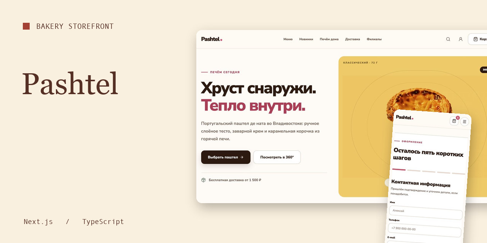
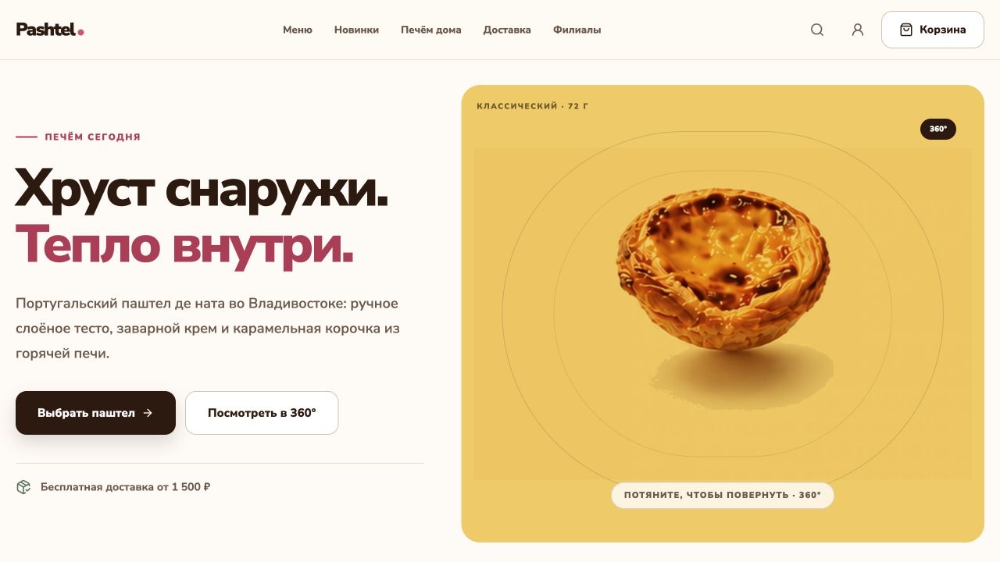
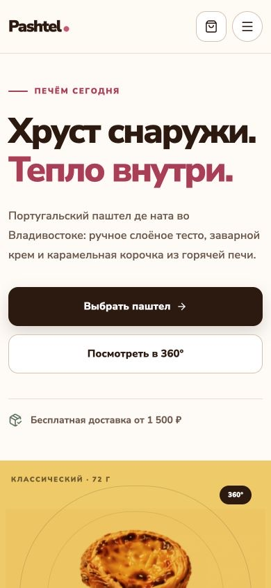

# Pashtel

Интернет-витрина пекарни. Покупатель выбирает выпечку, меняет количество в корзине и проходит пять шагов оформления.

Демонстрационный магазин · Публичная витрина приватного проекта  
Next.js · TypeScript

## Что проверяется при оформлении

Корзина показывает состав и сумму заказа. При оформлении интерфейс подсвечивает ошибки ввода, а сервер повторно проверяет данные и пересчитывает итоговую стоимость.

Демо заканчивается проверкой заказа. Реальная оплата и отправка отключены.

## Один заказ на двух экранах

**[Оформление на компьютере](assets/screen-checkout-desktop.jpg)** · На первом шаге покупатель вводит контактные данные. Справа остаётся сводка с составом и суммой заказа.

**[Та же форма на телефоне](assets/screen-checkout-mobile.jpg)** · Поля расположены друг под другом. Индикатор этапов и кнопка продолжения помогают пройти длинную форму по частям.

Развернуть галерею

[Примечание о проекте](NOTICE.md) · [Профиль](https://github.com/mrjakeball) · [Каталог проектов](https://github.com/mrjakeball/portfolio)
