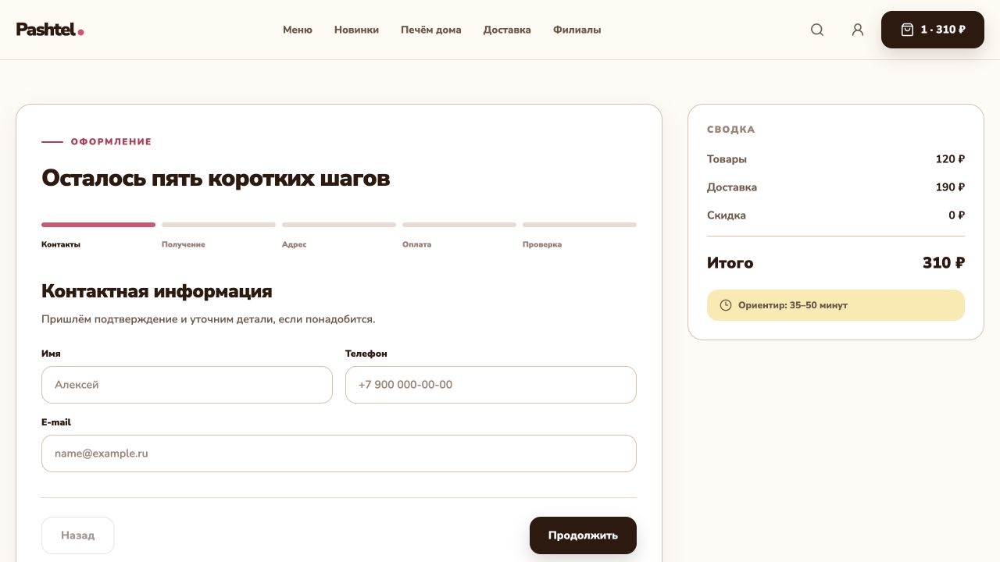
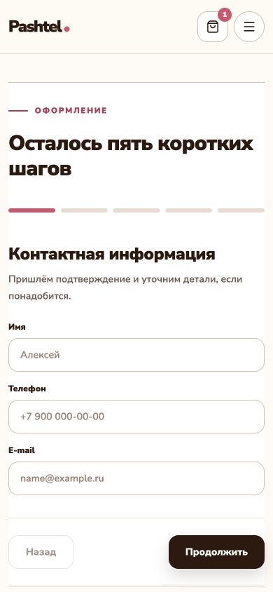

**RU** · [EN](README_EN.md)　 /　 [Профиль](https://github.com/mrjakeball) · [Каталог проектов](https://github.com/mrjakeball/portfolio)

# Pashtel

Интернет-витрина пекарни. Покупатель выбирает выпечку, меняет количество в корзине и проходит пять шагов оформления.

Демонстрационный магазин · Публичная витрина приватного проекта  
Next.js · TypeScript

## Что проверяется при оформлении

Корзина показывает состав и сумму заказа. При оформлении интерфейс подсвечивает ошибки ввода, а сервер повторно проверяет данные и пересчитывает итоговую стоимость.

Демо заканчивается проверкой заказа. Реальная оплата и отправка отключены.

## Исходные изображения

[Витрина пекарни](assets/cover.jpg) · [Оформление на компьютере](assets/screen-checkout-desktop.jpg) · [Оформление на телефоне](assets/screen-checkout-mobile.jpg) · [Мобильный каталог](assets/screen-home-mobile.jpg)

Развернуть галерею

[Примечание о проекте](NOTICE.md) · [Профиль](https://github.com/mrjakeball) · [Каталог проектов](https://github.com/mrjakeball/portfolio)
