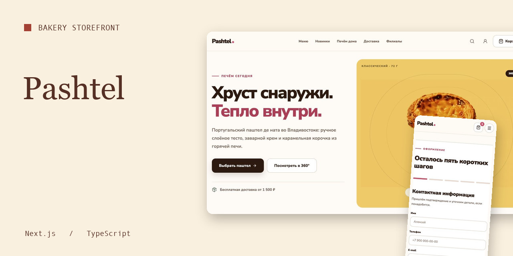
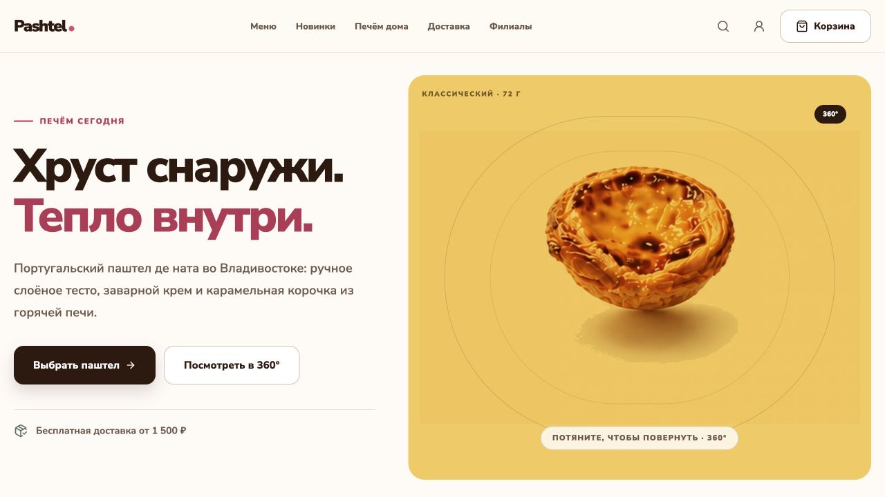
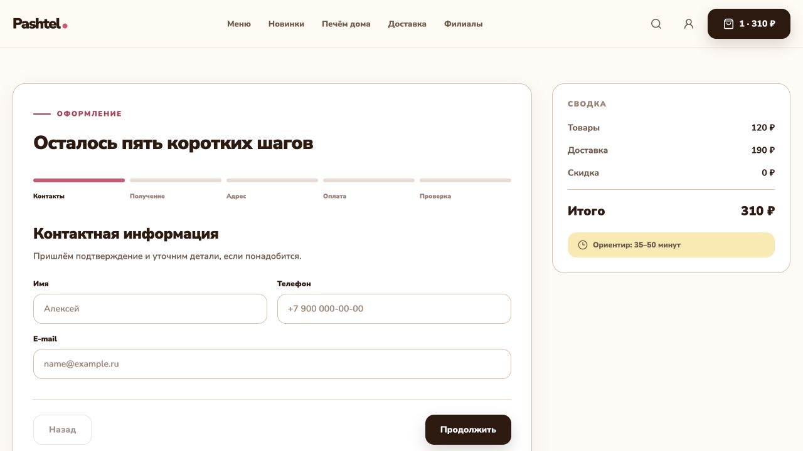
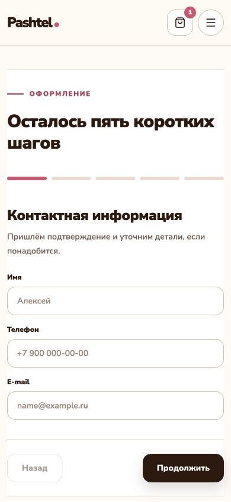
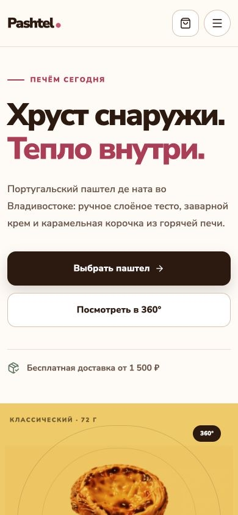

<a href="README.md"><picture><source media="(max-width: 600px)" srcset="https://raw.githubusercontent.com/mrjakeball/mrjakeball/main/assets/navigation/ru-off-compact.svg?v=2"></picture></a>
<a href="README_EN.md"><picture><source media="(max-width: 600px)" srcset="https://raw.githubusercontent.com/mrjakeball/mrjakeball/main/assets/navigation/en-on-compact.svg?v=2"></picture></a>
<a href="https://github.com/mrjakeball/portfolio/blob/main/README_EN.md"><picture><source media="(max-width: 600px)" srcset="https://raw.githubusercontent.com/mrjakeball/mrjakeball/main/assets/navigation/catalog-en-compact.svg?v=2"></picture></a>

# Pashtel

A bakery storefront. Customers choose pastries, adjust quantities in the basket and move through a five-step checkout.

Demo storefront · Public showcase of a private project  
Next.js · TypeScript

## What checkout validates

The basket shows the items and total. During checkout the interface flags input errors, and the server validates the submitted data and recalculates the total.

The demo ends with order review. Payments and dispatch are disabled.

## One checkout at two sizes

**[Desktop checkout](assets/screen-checkout-desktop.jpg)** · The first step collects contact details. The basket summary and total remain visible alongside the form.

**[Mobile checkout](assets/screen-checkout-mobile.jpg)** · Fields stack vertically. The step indicator and continue button let the customer work through the longer form in stages.

View the gallery

[Project notice](NOTICE.md) · [Profile](https://github.com/mrjakeball/mrjakeball/blob/main/README_EN.md) · [Project catalogue](https://github.com/mrjakeball/portfolio/blob/main/README_EN.md)
